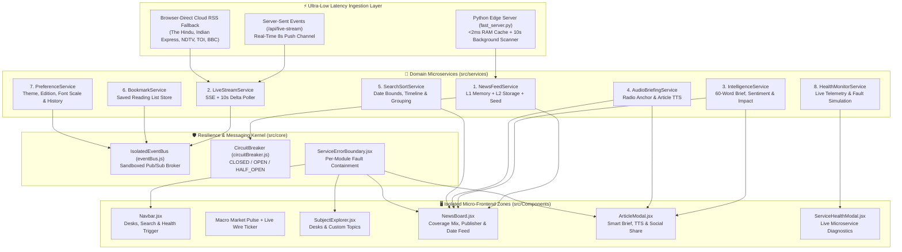

# 🇮🇳 NewsMag — Fault-Isolated Microservice Real-Time News & Macro Intelligence Platform

[](https://raw.githack.com/drkanurag/News_Application/main/index.html)
[](https://htmlpreview.github.io/?https://github.com/drkanurag/News_Application/blob/main/index.html)
[](https://drkanurag.github.io/News_Application/)
[](http://localhost:5173/launch.html)

> **NewsMag** is a next-generation, **microservice-architected real-time news and intelligence application** engineered for **ultra-low latency (`< 2ms` edge cache / `0ms` instant L1/L2 hydration)** and **fault isolation**. It delivers **~80% India National, Economic, Tech & State coverage** paired with **~20% strictly filtered Macro-Level International news** (geopolitics, central banks, global trade, sovereign summits, commodities, and frontier AI/space breakthroughs).

---

## 🌐 Direct Working Website Links (Click Any Link to Launch Immediately)

| Environment | Direct Clickable Link | Mode & Capabilities |
| :--- | :--- | :--- |
| 🌍 **1. Live Cloud Website (Primary CDN)** | **[🚀 Click Here to Open Live Website (`raw.githack.com`)](https://raw.githack.com/drkanurag/News_Application/main/index.html)** | **Works instantly on any device/browser** directly from GitHub with zero setup. Streams live Indian & Macro Global RSS wires in real time. |
| 🌐 **2. Live Cloud Mirror (`HTMLPreview`)** | **[⚡ Click Here to Open Live Mirror (`htmlpreview.github.io`)](https://htmlpreview.github.io/?https://github.com/drkanurag/News_Application/blob/main/index.html)** | Secondary cloud mirror rendering [`index.html`](./index.html) directly in the browser. |
| 📡 **3. GitHub Pages Deployment** | **[🇮🇳 Open GitHub Pages (`drkanurag.github.io/News_Application`)](https://drkanurag.github.io/News_Application/)** | Automated CI/CD deployment via [`.github/workflows/deploy-pages.yml`](./.github/workflows/deploy-pages.yml). |
| 💻 **4. Local Sub-2ms Edge Server** | **[🖥️ Open Local Edge App (`http://localhost:5173/launch.html`)](http://localhost:5173/launch.html)** | Connects to local [`fast_server.py`](./news/fast_server.py) for `< 2ms` RAM-cached feeds + `8s` Server-Sent Events (`/api/live-stream`). |

---

## ✨ Complete Feature Suite

### 1. 🇮🇳 India-First (80%) + 🌐 Macro-Level International (20%) Editorial Engine
- **80% India Coverage (`🇮🇳 INDIA`)**: Real-time ingestion from **The Hindu**, **The Indian Express**, **NDTV India / NDTV Profit / Gadgets 360**, **Times of India**, and **Google News India (`when:2h` Live Wire)** across all 7 desks (*Top Stories*, *Technology*, *Business*, *Science*, *Health*, *Sports*, *Entertainment*).
- **20% Macro-Level Global Coverage (`🌐 MACRO_GLOBAL`)**: Pulls from **BBC World / Economy / Tech**, **Al Jazeera Global**, **CNBC Global Macro**, and **Google News Macro Wire**, filtered through `is_macro_global_story()` to include **only macro-scale developments** (Federal Reserve, ECB, IMF, World Bank, BRICS, G20, UN, NATO, OPEC, Brent Crude, Gold, tariffs, semiconductor supply chains, and frontier AI/space milestones) while blocking foreign municipal/local noise.
- **Interactive Coverage Mix Bar**: Switch seamlessly between:
  - `🇮🇳 Mostly India + 🌐 Macro World` (Default 80% / 20% interleaved feed)
  - `🇮🇳 India Only` (100% domestic national, state, and economy stories)
  - `🌐 Macro International Only` (100% high-impact global macro events)

### 2. 🤖 AI 60-Word Executive Brief, Sentiment & Macro Impact Lens (`intelligenceService.js`)
- **3-Bullet Executive Summary**: Every story modal synthesizes the headline and wire report into 3 concise takeaways for 5-second reading.
- **"Why It Matters" Lens**: Automatically explains how each story affects either **Indian markets, policy & domestic growth** (`🇮🇳 INDIA`) or **global capital flows, supply chains & diplomacy** (`🌐 MACRO_GLOBAL`).
- **Domain Impact & Sentiment Badges**: Classifies every card by domain (*Markets & Monetary*, *Geopolitics & Diplomacy*, *AI & Frontier Tech*, *Space, Climate & Science*, *Governance & Law*) and sentiment (*Positive / Constructive*, *High Alert / Risk Watch*, *Policy / Analytical*).

### 3. 🎧 Hands-Free Audio News Anchor & Article Voice Reader (`audioBriefingService.js`)
- **Top 5 Live Radio Briefing (`🎧 Listen Top 5 Briefing`)**: One-click hands-free radio mode that reads the top 5 India & Macro headlines and their strategic impact back-to-back using natural Web Speech Synthesis (`en-IN` / `en-GB` / `en-US`).
- **Per-Article Voice Synthesis (`🔊 Listen`)**: Listen to any individual article card or smart brief modal on demand.

### 4. 📈 Live India & Global Macro Market Pulse Strip
- Real-time quick-filter strip displaying key benchmarks:
  - `🇮🇳 NIFTY 50` • `🇮🇳 SENSEX` • `💱 USD / INR` • `🏦 RBI REPO` • `🛢️ BRENT CRUDE` • `🪙 GOLD 24K (10g)` • `🌐 US FED RATE`
- Clicking any benchmark immediately filters the live news feed to stories impacting that market indicator.

### 5. 🏢 Publisher Wire Filter & 🔥 Trending Entities Bar
- **Publisher Filter Pills**: One-click filtering by active newsroom wire (*All Wires*, *The Hindu*, *The Indian Express*, *NDTV India*, *Times of India*, *BBC World Macro*, *Al Jazeera Global*, etc.) with live story counts.
- **Trending Entities (`#Topic`)**: Automatically extracts hot entities from the active stream (`#RBI`, `#Sensex`, `#Parliament`, `#SupremeCourt`, `#ISRO`, `#AI`, `#Oil`, `#Tariffs`) for instant topic drilling.

### 6. 📅 Chronological Date Grouping & Timeline Filter (`searchSortService.js`)
- Filter headlines by **All Real-Time**, **Today**, **Yesterday**, **Last 7 Days**, **Last 30 Days**, or select a **Custom Date Range (`From` – `To`)**.
- Automatically groups stories under chronological date headers (`Today`, `Yesterday`, and formatted calendar dates) with exact publication timestamps (`Oct 10, 2026, 05:45 PM`) and relative badges (`JUST IN`, `4m ago`).

### 7. 🧭 Dedicated News Subject & Custom Topic Explorer (`SubjectExplorer.jsx`)
- Browse **7 Editorial Desks**, **12 India & Macro Subject Presets** (*India National*, *Sensex, Nifty & RBI*, *Global Macro & Geopolitics*, *India Tech & AI*, *ISRO & Science*, *Cricket & Indian Sports*, *World Economy & Trade*, *Climate & Energy*, *Startups & Unicorns*, *Health & AIIMS/WHO*, *Defense & Strategy*, *Bollywood & Cinema*), or **create custom personal topic chips** persisted in `localStorage`.

### 8. 📖 Smart Reader Modal (`ArticleModal.jsx`)
- Includes **Reader Typography Controls (`A-`, `A`, `A+`)**, **60-Word Executive Brief**, **Voice Listen toggle**, **Bookmarking**, and one-click sharing to **WhatsApp**, **X (Twitter)**, **LinkedIn**, and **Copy Link**.

---

## 🏗️ Fault-Isolated Microservice Architecture

Every domain service and UI module is strictly decoupled. If any single upstream API or UI widget encounters an error, it is caught by its dedicated [`CircuitBreaker`](./news/src/core/circuitBreaker.js) and [`ServiceErrorBoundary`](./news/src/core/ServiceErrorBoundary.jsx) without affecting any other part of the application.



---

## 🧩 Microservice Catalog & Responsibilities

| # | Microservice / Module | File Path | Responsibility & Fault Isolation Guarantee |
| :-: | :--- | :--- | :--- |
| **1** | **Edge RAM Cache & SSE Server** | [`news/fast_server.py`](./news/fast_server.py) | Concurrent 16-worker XML RSS & Google News `when:2h` aggregator serving `/api/fast-news` in `< 2ms` and `/api/live-stream` via SSE. |
| **2** | **News Feed & Multi-Tier Cache** | [`news/src/services/newsFeedService.js`](./news/src/services/newsFeedService.js) | `0ms` L1 Memory Cache + `1ms` L2 `localStorage` Cache + progressive first-responder streaming and deduplication. |
| **3** | **Real-Time Live Stream Service** | [`news/src/services/liveStreamService.js`](./news/src/services/liveStreamService.js) | Subscribes to Server-Sent Events (`/api/live-stream`) and browser-direct RSS wires to push breaking headlines without page reloads. |
| **4** | **AI Executive Intelligence** | [`news/src/services/intelligenceService.js`](./news/src/services/intelligenceService.js) | Pure analytical service generating 3-bullet 60-word briefs, "Why It Matters" macro/India lenses, sentiment tags, and trending topics. |
| **5** | **Audio News Anchor & TTS** | [`news/src/services/audioBriefingService.js`](./news/src/services/audioBriefingService.js) | Hands-free Top-5 radio news briefing queue and single-article voice reader with `en-IN` voice prioritization. |
| **6** | **Search, Date & Timeline Engine** | [`news/src/services/searchSortService.js`](./news/src/services/searchSortService.js) | Stateless keyword filtering, custom date-range filtering (`Today`, `Yesterday`, `7d`, `30d`, `Custom`), and chronological date grouping. |
| **7** | **Bookmark & Reading List** | [`news/src/services/bookmarkService.js`](./news/src/services/bookmarkService.js) | Persists saved articles in `localStorage` with automatic in-memory fallback if browser storage is restricted. |
| **8** | **User Preference & History** | [`news/src/services/preferenceService.js`](./news/src/services/preferenceService.js) | Manages Dark/Light theme, India/Global edition, Grid/List layout, Reader font scale (`A-/A/A+`), and reading history. |
| **9** | **Service Health & Telemetry** | [`news/src/services/healthMonitorService.js`](./news/src/services/healthMonitorService.js) | Tracks live `HEALTHY` / `DEGRADED` / `ISOLATED_FAULT` states across all microservices and supports interactive fault simulation. |

---

## 📊 Performance & Latency Architecture

| Metric | Latency | Mechanism |
| :--- | :--- | :--- |
| **Initial Screen Paint (First Render)** | **`0 ms`** | Instant hydration from L1 in-memory snapshot / L2 `localStorage` cache (`getInstantSnapshot`). |
| **Local Edge API (`/api/fast-news`)** | **`< 2 ms`** | Pre-serialized UTF-8 JSON served from Python `RAM_CACHE` refreshed every 10 seconds in background threads. |
| **Category Hover Prefetch** | **`0 ms` on click** | `prefetchOnHover` pre-loads category feeds when the cursor hovers over any navbar or subject pill. |
| **Real-Time Breaking News Push** | **Every `8–10 s`** | Persistent HTTP Server-Sent Events (`/api/live-stream`) + background delta merge (`+N New Live`). |

---

## 📂 Repository Directory Structure

```text
News_Application/
├── index.html                        # Root standalone cloud/local hybrid web app (Live on GitHub CDN & Pages)
├── launch.html                       # Direct standalone application entry point
├── README.md                         # Master project documentation & live launch links
├── .github/
│   └── workflows/
│       └── deploy-pages.yml          # Automated GitHub Pages CI/CD workflow
└── news/
    ├── fast_server.py                # Sub-2ms Python RAM Cache + SSE (/api/live-stream) Server
    ├── launch.html                   # Standalone zero-build production bundle
    ├── start_newsmag.bat             # One-click Windows server + browser auto-launcher
    ├── package.json                  # React 18 + Vite 5 project manifest
    ├── vite.config.js                # Vite configuration
    └── src/
        ├── App.jsx                   # Root application shell & microservice orchestrator
        ├── App.css                   # Glassmorphic dark/light theme & responsive styling
        ├── core/
        │   ├── eventBus.js           # Sandboxed Pub/Sub broker (try/catch per subscriber)
        │   ├── circuitBreaker.js     # Upstream API Circuit Breaker (CLOSED / OPEN / HALF_OPEN)
        │   └── ServiceErrorBoundary.jsx # Per-module React Error Boundary with hot recovery
        ├── services/
        │   ├── newsFeedService.js    # Multi-stream India + Macro gateway & L1/L2 cache
        │   ├── liveStreamService.js  # Real-time SSE + RSS publisher wire service
        │   ├── intelligenceService.js# 60-word AI Executive Brief, Sentiment & Impact service
        │   ├── audioBriefingService.js # Hands-free Radio Briefing & per-article Voice TTS
        │   ├── searchSortService.js  # Keyword, date-range & chronological grouping service
        │   ├── bookmarkService.js    # Isolated localStorage + memory fallback reading list
        │   ├── preferenceService.js  # Theme, country edition, font scale & read history
        │   └── healthMonitorService.js # Real-time microservice health & telemetry registry
        └── Components/
            ├── Navbar.jsx            # Navigation, Search, Edition & Services Health trigger
            ├── SubjectExplorer.jsx   # Dedicated News Subjects & Custom Topic chooser
            ├── NewsBoard.jsx         # Macro Pulse, Coverage Mix, Publisher Filter & Feed
            ├── NewsItem.jsx          # Resilient article card with INDIA/MACRO & Voice TTS
            ├── ArticleModal.jsx      # 60-Word Executive Brief, Font Controls & Social Share
            ├── ServiceHealthModal.jsx# Live Microservice Health & Fault Simulation console
            └── fallbackData.js       # India + Macro Subjects catalog & date utilities
```

---

## 🚀 How to Run the Project

### Option 1: Instant Online Launch (Zero Installation)
Click the live link directly from this README:
👉 **[https://raw.githack.com/drkanurag/News_Application/main/index.html](https://raw.githack.com/drkanurag/News_Application/main/index.html)**

### Option 2: One-Click Local Edge Server + Auto-Browser Launch (Windows)
Double-click [`news/start_newsmag.bat`](./news/start_newsmag.bat) or run in terminal:
```powershell
cd news
python fast_server.py
```
Then open **[http://localhost:5173/launch.html](http://localhost:5173/launch.html)** (or **[http://localhost:5173](http://localhost:5173)**).

### Option 3: Vite + React Development Server
```bash
cd news
npm install
npm run dev
```
