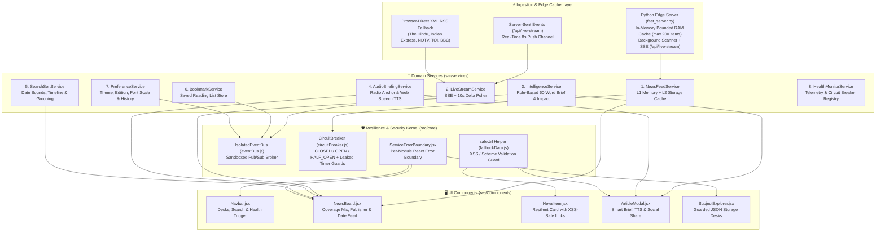

# 🇮🇳 NewsMag — Fault-Isolated Real-Time News & Macro Intelligence Platform

[](https://drkanurag.github.io/News_Application/)
[](https://drkanurag.github.io/News_Application/)
[](https://github.com/drkanurag/News_Application/actions)
[](http://localhost:5173/)

> **NewsMag** is a high-performance **modular real-time news and intelligence application** engineered for **ultra-low latency (`< 2ms` in-memory edge cache / `0ms` instant client snapshot)** and **fault isolation**. It delivers **~80% India National, Economic, Tech & State coverage** paired with **~20% strictly filtered Macro-Level International news** (central banks, global trade, sovereign summits, energy, commodities, and frontier AI/space breakthroughs).

---

## 🌐 Direct Working Website Links (Click Any Link to Launch Immediately)

| Environment | Direct Clickable Link | Mode & Capabilities |
| :--- | :--- | :--- |
| 🌍 **1. Official Live Website (GitHub Pages)** | **[🚀 Click Here to Open Live Website (`drkanurag.github.io/News_Application`)](https://drkanurag.github.io/News_Application/)** | **Official deployed web application** running the pre-compiled, optimized React 18 production bundle. Streams live publisher wires directly on any device with zero setup. |
| 🌐 **2. Instant Standalone Cloud Mirror (`raw.githack.com`)** | **[⚡ Click Here to Open Standalone Mirror](https://raw.githack.com/drkanurag/News_Application/main/launch.html)** | Direct CDN mirror running [`launch.html`](./launch.html) with inlined styles and real-time RSS streaming. |
| 💻 **3. Local Sub-2ms Edge Server** | **[🖥️ Open Local Edge App (`http://localhost:5173`)](http://localhost:5173)** | Connects to local [`fast_server.py`](./news/fast_server.py) for `< 2ms` RAM-cached feeds + Server-Sent Events (`/api/live-stream`). |

---

## ✨ Complete Feature Suite

### 1. 🇮🇳 India-First (80%) + 🌐 Macro-Level International (20%) Editorial Engine
- **80% India Coverage (`🇮🇳 INDIA`)**: Real-time ingestion from **The Hindu**, **The Indian Express**, **NDTV India / NDTV Profit / Gadgets 360**, **Times of India**, and **Google News India Live Wire** across all 7 editorial desks (*Top Stories*, *Technology*, *Business*, *Science*, *Health*, *Sports*, *Entertainment*).
- **20% Macro-Level Global Coverage (`🌐 MACRO_GLOBAL`)**: Curated from **BBC World / Economy / Tech**, **Al Jazeera Global**, **CNBC Global Macro**, and **Google News Macro Wire**, filtered through `is_macro_global_story()` to include **only macro-scale developments** (Federal Reserve, ECB, RBI, IMF, World Bank, BRICS, G20, UN, NATO, OPEC, Brent Crude, Gold, tariffs, semiconductor supply chains, and frontier AI/space milestones) while blocking foreign municipal/local noise.
- **Interactive Coverage Mix Bar**: Switch seamlessly between:
  - `🇮🇳 Mostly India + 🌐 Macro World` (Default 80% / 20% interleaved feed)
  - `🇮🇳 India Only` (100% domestic national, state, and economy stories)
  - `🌐 Macro International Only` (100% high-impact global macro events)

### 2. 🤖 Rule-Based 60-Word Smart Brief, Sentiment & Macro Impact Lens (`intelligenceService.js`)
- **3-Bullet Executive Summary**: Every story modal synthesizes the headline and wire report into 3 concise takeaways for 5-second reading.
- **"Why It Matters" Lens**: Automatically explains how each story affects either **Indian markets, policy & domestic growth** (`🇮🇳 INDIA`) or **global capital flows, supply chains & diplomacy** (`🌐 MACRO_GLOBAL`).
- **Domain Impact & Sentiment Badges**: Classifies every card by domain (*Markets & Monetary*, *Geopolitics & Diplomacy*, *AI & Frontier Tech*, *Space, Climate & Science*, *Governance & Law*) and sentiment (*Positive / Constructive*, *High Alert / Risk Watch*, *Policy / Analytical*).

### 3. 🎧 Hands-Free Audio News Anchor & Article Voice Reader (`audioBriefingService.js`)
- **Top 5 Live Radio Briefing (`🎧 Listen Top 5 Briefing`)**: One-click hands-free radio mode that reads the top 5 India & Macro headlines and their strategic impact back-to-back using the browser Web Speech Synthesis API (`en-IN` / `en-GB` / `en-US`).
- **Per-Article Voice Synthesis (`🔊 Listen`)**: Listen to any individual article card or smart brief modal on demand.

### 4. 📈 Live India & Global Macro Market Pulse Strip
- Real-time quick-filter strip displaying key benchmarks:
  - `🇮🇳 NIFTY 50` • `🇮🇳 SENSEX` • `💱 USD / INR` • `🏦 RBI REPO` • `🛢️ BRENT CRUDE` • `🪙 GOLD 24K (10g)` • `🌐 US FED RATE`
- Clicking any benchmark immediately filters the live news feed to stories impacting that market indicator.

### 5. 🏢 Publisher Wire Filter & 🔥 Trending Entities Bar
- **Publisher Filter Pills**: One-click filtering by active newsroom wire (*All Wires*, *The Hindu*, *The Indian Express*, *NDTV India*, *Times of India*, *BBC World Macro*, *Al Jazeera Global*, etc.) with live story counts.
- **Trending Entities (`#Topic`)**: Automatically extracts hot entities from the active stream (`#RBI`, `#Sensex`, `#Parliament`, `#SupremeCourt`, `#ISRO`, `#AI`, `#Oil`, `#Tariffs`) for instant topic drilling.

### 6. 📅 Chronological Date Grouping & Timeline Filter (`searchSortService.js`)
- Filter headlines by **All Real-Time**, **Today**, **Yesterday**, **Last 7 Days**, **Last 30 Days**, or select a **Custom Date Range (`From` – `To`)**.
- Automatically groups stories under chronological date headers (`Today`, `Yesterday`, and formatted calendar dates) with exact publication timestamps (`Oct 10, 2026, 05:45 PM`) and relative badges (`JUST IN`, `4m ago`).

### 7. 🧭 Dedicated News Subject & Custom Topic Explorer (`SubjectExplorer.jsx`)
- Browse **7 Editorial Desks**, **12 India & Macro Subject Presets** (*India National*, *Sensex, Nifty & RBI*, *Global Macro & Geopolitics*, *India Tech & AI*, *ISRO & Science*, *Cricket & Indian Sports*, *World Economy & Trade*, *Climate & Energy*, *Startups & Unicorns*, *Health & AIIMS/WHO*, *Defense & Strategy*, *Bollywood & Cinema*), or **create custom personal topic chips** persisted in `localStorage`.

### 8. 📖 Smart Reader Modal (`ArticleModal.jsx`)
- Includes **Reader Typography Controls (`A-`, `A`, `A+`)**, **60-Word Executive Brief**, **Voice Listen toggle**, **Bookmarking**, and one-click sharing to **WhatsApp**, **X (Twitter)**, **LinkedIn**, and **Copy Link**.

---

## 🏗️ Modular Architecture & Fault Isolation

Every domain service and UI module is strictly decoupled. If any single upstream API or UI widget encounters an error, it is caught by its dedicated [`CircuitBreaker`](./news/src/core/circuitBreaker.js) and [`ServiceErrorBoundary`](./news/src/core/ServiceErrorBoundary.jsx) without affecting any other part of the application.



---

## 🧩 Service Catalog & Responsibilities

| # | Service / Module | File Path | Responsibility & Security Guarantees |
| :-: | :--- | :--- | :--- |
| **1** | **Edge RAM Cache & SSE Server** | [`news/fast_server.py`](./news/fast_server.py) | Python server with bounded in-memory cache (max 200 items, pruned on TTL), URL verification, path traversal/source protection (404 on `.py`, `.env`, `.bat`, `.json`), defusedxml safe parsing, serving `/api/fast-news` and `/api/live-stream`. |
| **2** | **News Feed & Multi-Tier Cache** | [`news/src/services/newsFeedService.js`](./news/src/services/newsFeedService.js) | `0ms` L1 Memory Cache + L2 `localStorage` Cache + progressive first-responder streaming without exposing client-side API keys. |
| **3** | **Real-Time Live Stream Service** | [`news/src/services/liveStreamService.js`](./news/src/services/liveStreamService.js) | Subscribes to Server-Sent Events (`/api/live-stream`) and browser-direct RSS wires with schema-validated JSON payload guards. |
| **4** | **Executive Intelligence Service** | [`news/src/services/intelligenceService.js`](./news/src/services/intelligenceService.js) | Rule-based analytical engine generating 3-bullet 60-word briefs, "Why It Matters" macro/India lenses, sentiment tags, and trending topics. |
| **5** | **Audio News Anchor & TTS** | [`news/src/services/audioBriefingService.js`](./news/src/services/audioBriefingService.js) | Hands-free Top-5 radio news briefing queue and single-article voice reader using browser Web Speech API. |
| **6** | **Search, Date & Timeline Engine** | [`news/src/services/searchSortService.js`](./news/src/services/searchSortService.js) | Stateless keyword filtering, custom date-range filtering (`Today`, `Yesterday`, `7d`, `30d`, `Custom`), and chronological date grouping. |
| **7** | **Bookmark & Reading List** | [`news/src/services/bookmarkService.js`](./news/src/services/bookmarkService.js) | Persists saved articles in `localStorage` with shape-validation and memory fallback. |
| **8** | **User Preference & History** | [`news/src/services/preferenceService.js`](./news/src/services/preferenceService.js) | Manages Dark/Light theme, India/Global edition, Grid/List layout, Reader font scale, and reading history. |
| **9** | **Service Health & Telemetry** | [`news/src/services/healthMonitorService.js`](./news/src/services/healthMonitorService.js) | Tracks live `HEALTHY` / `DEGRADED` states across all microservices and monitors upstream circuit breakers. |

---

## 📂 Repository Directory Structure

```text
News_Application/
├── index.html                        # Standalone web app entry (zero-build CDN mirror)
├── launch.html                       # Standalone application mirror
├── README.md                         # Master documentation & direct website launch links
├── .gitignore                        # Global ignore rules (.env, node_modules, dist)
├── .github/
│   └── workflows/
│       └── deploy-pages.yml          # Automated CI/CD: npm test gate + Vite build + Pages deploy
└── news/
    ├── fast_server.py                # Python Edge Server (bounded cache, safe XML, SSE push)
    ├── launch.html                   # Local standalone mirror
    ├── start_newsmag.bat             # One-click Windows runner (python fast_server.py)
    ├── package.json                  # React 18 + Vite 5 + Vitest test runner
    ├── vite.config.js                # Vite build configuration (base: /News_Application/)
    ├── .env.example                  # Environment template (NEWSAPI_KEY=your_key_here)
    ├── dist/                         # Compiled, optimized production bundle for GitHub Pages
    └── src/
        ├── App.jsx                   # Application shell & orchestrator
        ├── App.css                   # Glassmorphic dark/light theme & layout styles
        ├── core/
        │   ├── eventBus.js           # Decoupled Pub/Sub event broker
        │   ├── circuitBreaker.js     # Upstream Circuit Breaker with timeout timer leak guards
        │   └── ServiceErrorBoundary.jsx # React Error Boundary per module
        ├── services/                 # Decoupled domain microservices
        ├── Components/               # React UI components with safeUrl XSS protection
        └── __tests__/
            └── app.test.js           # Automated Vitest test suite (9 passing tests)
```

---

## 🚀 How to Run the Project

### Option 1: Instant Online Launch (Direct Website Link)
Click the official live link directly from this README:
👉 **[https://drkanurag.github.io/News_Application/](https://drkanurag.github.io/News_Application/)**

### Option 2: Local Edge Server (Recommended for Real-Time SSE Stream)
Run in terminal or double-click [`news/start_newsmag.bat`](./news/start_newsmag.bat):
```bash
cd news
python fast_server.py
```
Then open your browser at **[http://localhost:5173/](http://localhost:5173/)**.

### Option 3: Vite React Development Server
```bash
cd news
npm install
npm run dev
```

### Option 4: Run Automated Unit Tests (CI Gate)
```bash
cd news
npm test
```
All 9 unit tests run and verify security sanitization, circuit breaker state transitions, and search/sort operations.
